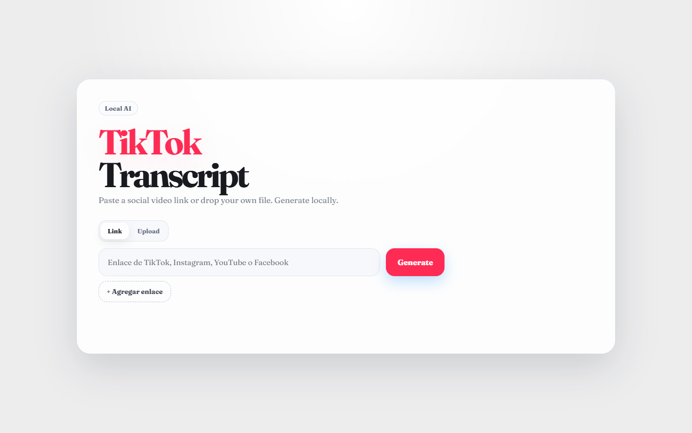
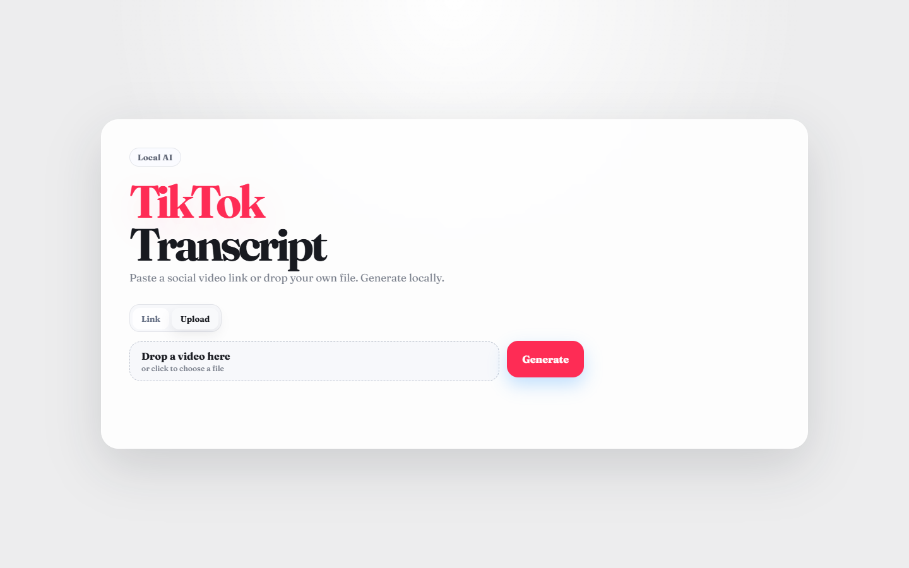
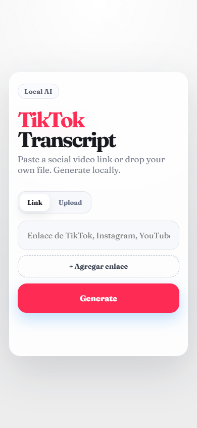

# TikTok Local Transcriber

### Del video a un texto con el que se puede trabajar

Herramienta local de transcripción de videos de TikTok, construida para procesar contenido en la propia computadora.

**Periodo documentado:** 2026  
**Estado:** Herramienta local; código privado  
**Tecnologías:** Python · transcripción de audio

## Qué hace

- Inicio local desde un acceso directo o script.
- Interfaz web local para el flujo de transcripción.
- Base de transcripción con MOSS-Transcribe-Diarize.

## Vista del proyecto

Capturas de la interfaz local en estado vacío, octubre de 2026. No se muestran videos, audio ni transcripciones personales.

### Interfaz de escritorio de TikTok Local Transcriber

### Flujo de carga de archivos en la interfaz local

### Interfaz local en pantalla móvil

## Contexto

Herramienta personal.

Esta vitrina contiene únicamente texto e imágenes seleccionadas para presentación. El código fuente, los datos y el historial del proyecto no se publican aquí.

[Ver la ficha visual de TikTok Local Transcriber](https://alfredoae2578.github.io/projects/tiktok-local-transcriber-presentacion.html)

[Ver todos los proyectos](https://alfredoae2578.github.io/)
